# WMS 全系统详细流程图册
制图日期：2026-10-14；代码基线：`21b97ce28ad0a72929381b89b1739d0c40b5b7ef`。
本册按当前代码描述30个专题。蓝框为数据、橙框为人工、绿框为库存动作、红框为限制、紫虚框为可选分支；虚线表示回退或汇合。
当前代码支持的操作可能比旧状态表更多，详见附录。

## 01 全系统业务总览

入口：首页 / 主菜单。
库存影响：业务单据完成后按仓库记账；基础资料、订单、BOM、报表本身不等于库存变动。。

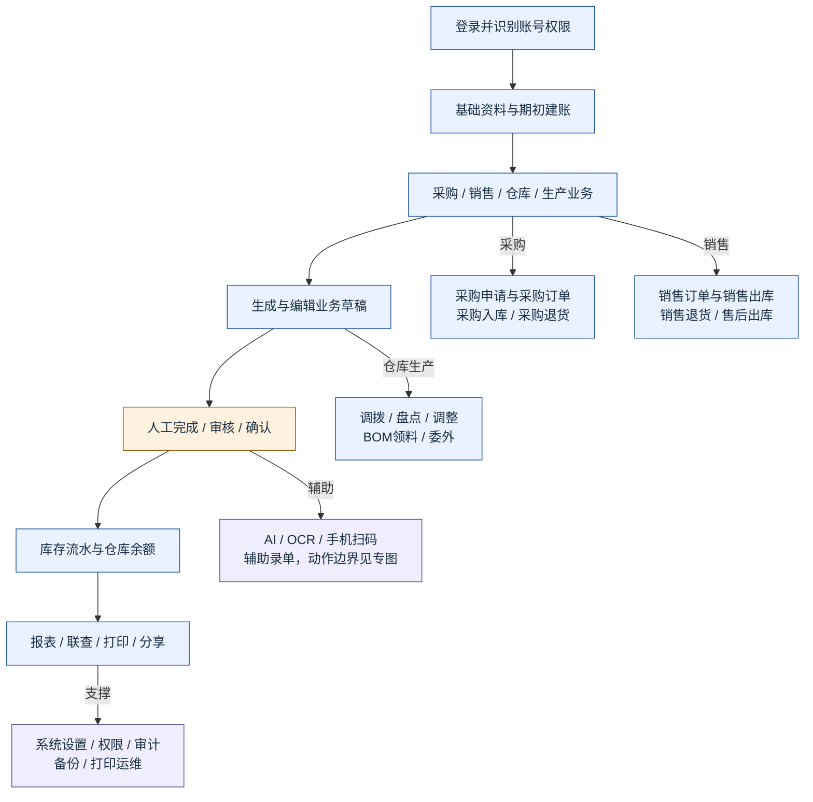

### 操作与口径

1. 主图是业务关系总览，不表示采购、销售和生产必须依次执行。各模块可独立录单，关联单据通过来源行与数量跟踪衔接。
2. 当前项目面向单人日常仓储登记；环境画像为4个仓库、库位管理未开启。库位开关变化后，所有相关图切换到仓库+库位校验。
3. BOM表管理已在基础资料；工单领料列表已增加按BOM领料。不要将BOM领料等同于完整生产计划、工序管理或自动成品入库。
4. 库存、单据、订单执行、打印任务和AI识别任务是不同状态体系，不能用同一个“完成”来替代。

### 核对来源

- [app/templates/base.html:1](https://github.com/SIX2090/wms/blob/21b97ce28ad0a72929381b89b1739d0c40b5b7ef/app/templates/base.html#L1)
- [app/models/documents.py:1](https://github.com/SIX2090/wms/blob/21b97ce28ad0a72929381b89b1739d0c40b5b7ef/app/models/documents.py#L1)
- [WMS_BUSINESS_SCOPE.md:1](https://github.com/SIX2090/wms/blob/21b97ce28ad0a72929381b89b1739d0c40b5b7ef/WMS_BUSINESS_SCOPE.md#L1)
- [INVENTORY_TRUTH.md:1](https://github.com/SIX2090/wms/blob/21b97ce28ad0a72929381b89b1739d0c40b5b7ef/INVENTORY_TRUTH.md#L1)

## 02 基础资料与物料档案

入口：基础资料；供应商与客户亦有业务菜单入口。
库存影响：常规资料维护不产生库存流水；期初库存另走建账流程。。

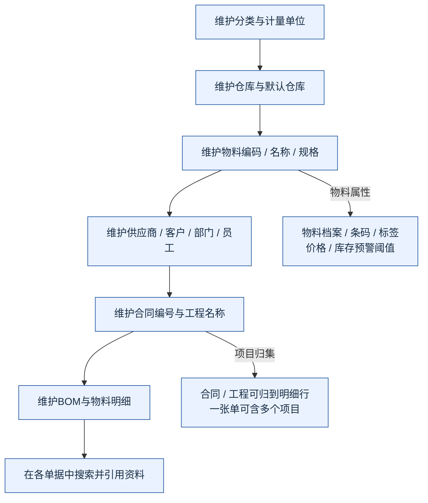

### 操作与口径

1. 仓库是物理设施，库位是仓内储位；两个概念不能互相替代。有效默认仓库用于缺省带入，没有有效默认值时由操作员选择。
2. 物料快速选择支持编码、名称及相应规格字段，键盘上下选择、Enter确认；批量导入和一物多码治理仍须按匹配结果人工确认。
3. 合同/工程是登记和报表归集维度，不是库存所有者唯一键。物料、合同或单位被业务引用后，其可改/可删范围由对应接口决定。
4. 物料初始化库存和期初库存属于建账动作；不能把资料编辑流程画成可以任意覆盖库存余额。

### 核对来源

- [app/routes/material.py:1](https://github.com/SIX2090/wms/blob/21b97ce28ad0a72929381b89b1739d0c40b5b7ef/app/routes/material.py#L1)
- [app/routes/warehouse.py:1](https://github.com/SIX2090/wms/blob/21b97ce28ad0a72929381b89b1739d0c40b5b7ef/app/routes/warehouse.py#L1)
- [app/routes/contract.py:1](https://github.com/SIX2090/wms/blob/21b97ce28ad0a72929381b89b1739d0c40b5b7ef/app/routes/contract.py#L1)
- [app/routes/options_api.py:1](https://github.com/SIX2090/wms/blob/21b97ce28ad0a72929381b89b1739d0c40b5b7ef/app/routes/options_api.py#L1)
- [app/models/master_data.py:1](https://github.com/SIX2090/wms/blob/21b97ce28ad0a72929381b89b1739d0c40b5b7ef/app/models/master_data.py#L1)

## 03 期初库存与正式建账

入口：基础资料 → 期初库存。
库存影响：新建行增加库存；修改数量按差额记账；删除行/整单逐行回冲。。

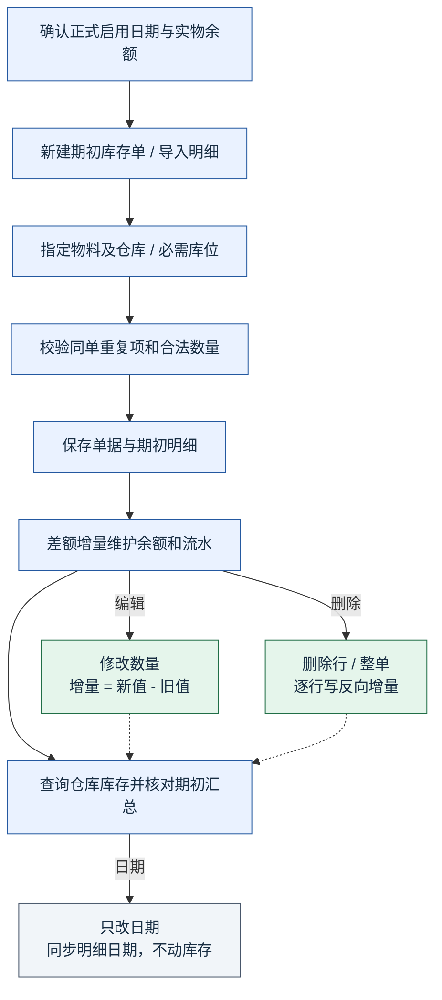

### 操作与口径

1. 同物料同仓库可以分布在多张期初单据中。期初总量是这些明细行之和，不能只取第一行。
2. OpeningStockDoc是单据头，OpeningStock是明细行；历史未归单记录仍应参与累计口径。
3. 期初单status为active，不使用普通出入库的pending→completed按钮流转。删除必须伴随库存回冲。
4. 上线前先核对实物，保存后检查库存台账；本流程图不执行建账或改动生产余额。

### 核对来源

- [app/routes/opening_stock.py:1](https://github.com/SIX2090/wms/blob/21b97ce28ad0a72929381b89b1739d0c40b5b7ef/app/routes/opening_stock.py#L1)
- [app/models/documents.py:1](https://github.com/SIX2090/wms/blob/21b97ce28ad0a72929381b89b1739d0c40b5b7ef/app/models/documents.py#L1)
- [INVENTORY_TRUTH.md:1](https://github.com/SIX2090/wms/blob/21b97ce28ad0a72929381b89b1739d0c40b5b7ef/INVENTORY_TRUTH.md#L1)

## 04 普通单据与待办处理总流程

入口：各类单据新增、列表、详情；待办单据入口。
库存影响：普通库存单据草稿不动库存；完成和反提交产生对称库存变动。。

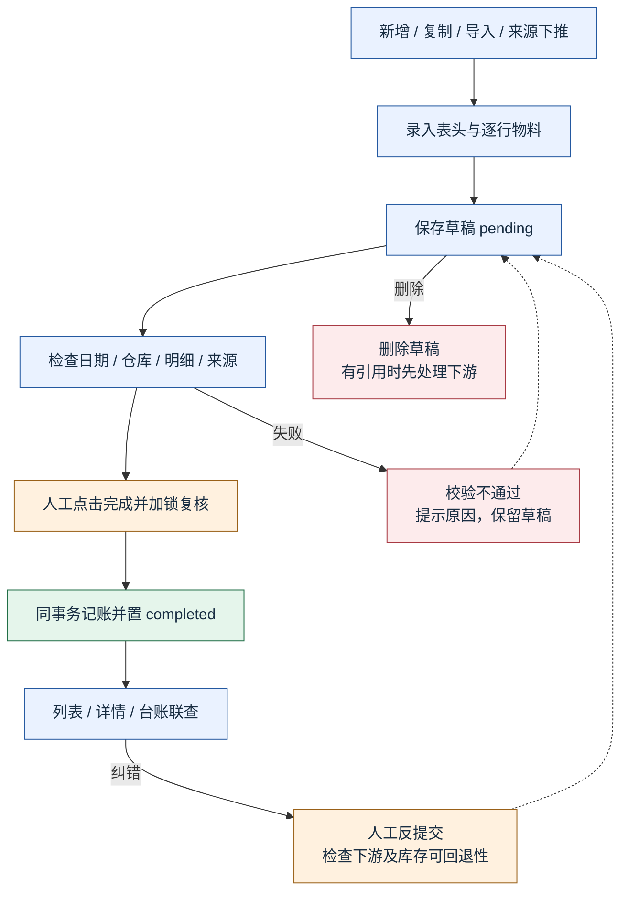

### 操作与口径

1. 本图适用于入库、出库、领料、售后、调拨子流程的共同骨架，采购申请、销售订单、期初和打印任务各有专门状态图。
2. 已完成入库不能直接删除；先人工反提交，准确回退库存，再删除草稿。其他单据也必须遵守其状态与引用校验。
3. 一条业务链存在下游单据时，先检查下游草稿或有效下推关系，再反提交上游，不能把撤销理解为无条件按钮。
4. 批量完成遵循同样的仓库、数量与状态校验；输出列表分页不能充当全集汇总。

### 核对来源

- [app/routes/pending_documents.py:1](https://github.com/SIX2090/wms/blob/21b97ce28ad0a72929381b89b1739d0c40b5b7ef/app/routes/pending_documents.py#L1)
- [app/routes/in_order.py:1](https://github.com/SIX2090/wms/blob/21b97ce28ad0a72929381b89b1739d0c40b5b7ef/app/routes/in_order.py#L1)
- [app/routes/out_order.py:1](https://github.com/SIX2090/wms/blob/21b97ce28ad0a72929381b89b1739d0c40b5b7ef/app/routes/out_order.py#L1)
- [app/services/warehouse_stock_service.py:1](https://github.com/SIX2090/wms/blob/21b97ce28ad0a72929381b89b1739d0c40b5b7ef/app/services/warehouse_stock_service.py#L1)

## 05 采购申请与审批中心

入口：采购管理 → 采购申请 / 审批中心。
库存影响：申请、审批、下推采购订单均不直接改变库存。。

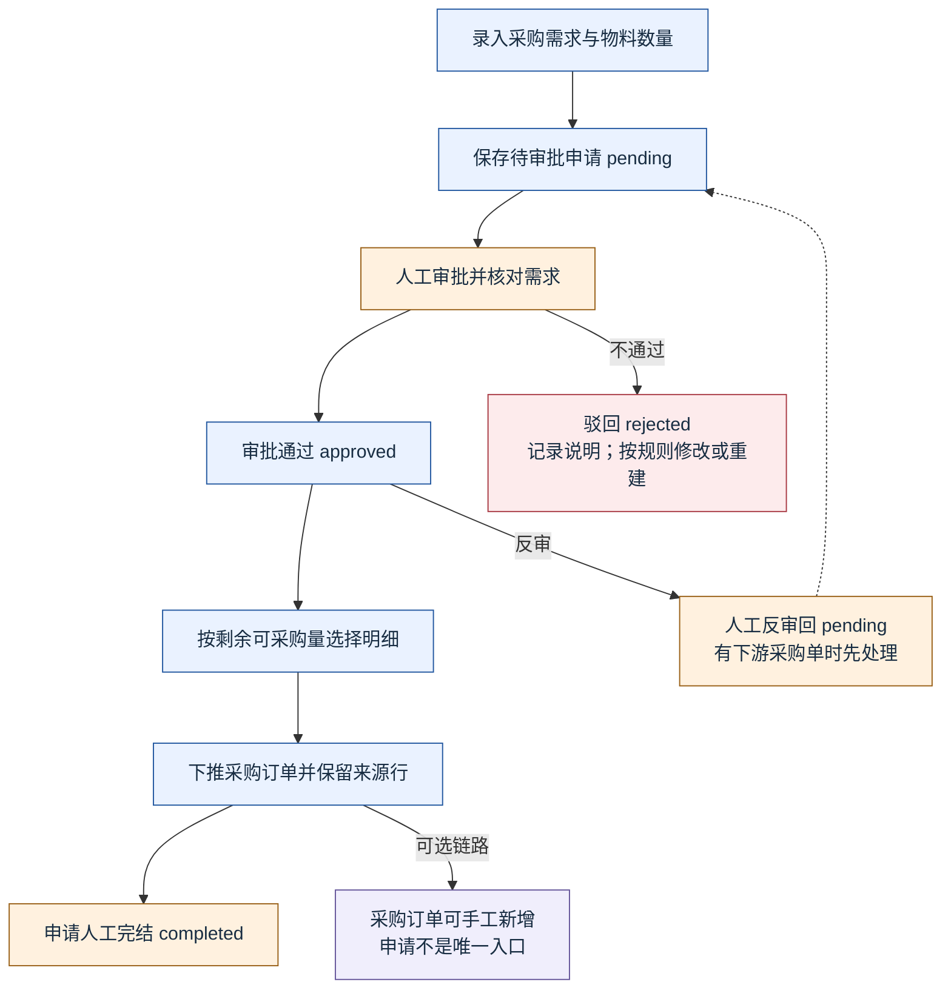

### 操作与口径

1. 审批中心当前主要承载采购申请，不代表所有入出库都存在额外审核岗。当前单人场景可以由有权限的管理员完成相应人工动作。
2. 已审批申请可以选择部分数量下推，多次采购必须看剩余可采购量与下游行级关联，不能默认整单重复采购。
3. 申请完成要求已审批；已审批/已完成申请反审前检查是否存在关联采购订单。待审批/驳回申请的删除规则见实际接口。
4. “申请已完成”和“物料已经入库”是不同含义；入库事实必须由已完成的入库单证明。

### 核对来源

- [app/routes/purchase_request.py:1](https://github.com/SIX2090/wms/blob/21b97ce28ad0a72929381b89b1739d0c40b5b7ef/app/routes/purchase_request.py#L1)
- [app/routes/approval.py:1](https://github.com/SIX2090/wms/blob/21b97ce28ad0a72929381b89b1739d0c40b5b7ef/app/routes/approval.py#L1)
- [app/models/documents.py:1](https://github.com/SIX2090/wms/blob/21b97ce28ad0a72929381b89b1739d0c40b5b7ef/app/models/documents.py#L1)

## 06 采购订单与分批收货

入口：采购管理 → 采购订单 / 采购订单列表。
库存影响：订单与收货草稿不增加库存；采购入库完成才实际入库。。

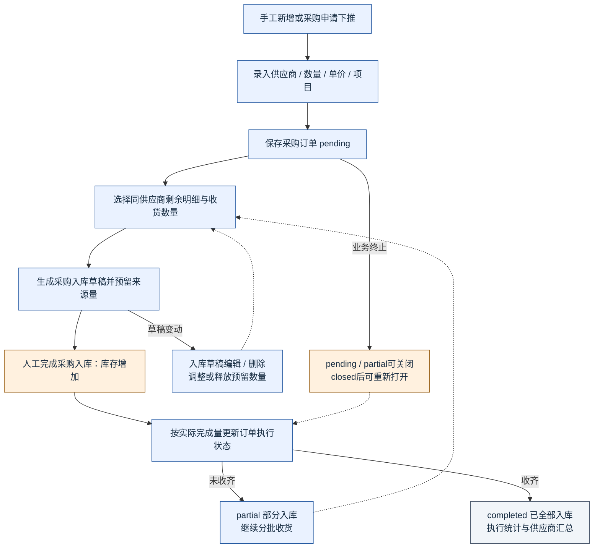

### 操作与口径

1. 采购订单是采购入库的可选来源，正常手工采购入库不强制关联订单；可选严格配置的具体表现应按系统设置核对。
2. 来源行received_quantity包含已生成入库明细的预留量；订单status由已完成入库数量聚合判定，不能把预留量称作实际到库。
3. 反提交入库只回退库存，不自动释放草稿的采购来源预留；修改/删除草稿时按来源行差额调整。再次完成不能重复累计预留。
4. 选单合并必须为同一供应商，保留各来源订单行及合同/工程。采购订单关闭/重开不产生库存流水。

### 核对来源

- [app/routes/purchase_order.py:1](https://github.com/SIX2090/wms/blob/21b97ce28ad0a72929381b89b1739d0c40b5b7ef/app/routes/purchase_order.py#L1)
- [app/routes/in_order.py:1](https://github.com/SIX2090/wms/blob/21b97ce28ad0a72929381b89b1739d0c40b5b7ef/app/routes/in_order.py#L1)
- [app/app.py#update_purchase_order_status:6222](https://github.com/SIX2090/wms/blob/21b97ce28ad0a72929381b89b1739d0c40b5b7ef/app/app.py#L6222)
- [app/app.py#validate_purchase_receive_quantity:6278](https://github.com/SIX2090/wms/blob/21b97ce28ad0a72929381b89b1739d0c40b5b7ef/app/app.py#L6278)

## 07 采购、产品、其他入库与客供登记

入口：采购入库 / 产品入库 / 其他入库。
库存影响：人工完成入库时按明细增加选定仓库库存；反提交写反向增量。。

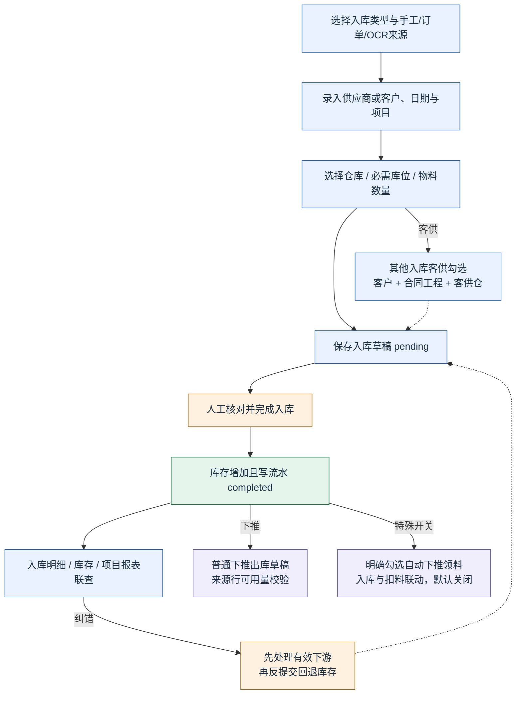

### 操作与口径

1. 采购入库、产品入库、其他入库和销售退货入库复用InOrder体系；产品入库可手工登记，不表示系统具有自动生产完工闭环。
2. 入库明细可记录批次号/有效期事实，但当前不能宣称库存余额已经按批次、序列号或所有权拆分。
3. 客供标识不建立独立owner余额账。客供行不能走普通下推出库；直接出库时按客供仓与合同/工程登记。
4. 自动下推领料是操作员明确选择的特殊联动：可生成已完成普通领料出库并扣料；它不同于BOM生成工单领料草稿，必须单独看开关。

### 核对来源

- [app/routes/in_order.py:1](https://github.com/SIX2090/wms/blob/21b97ce28ad0a72929381b89b1739d0c40b5b7ef/app/routes/in_order.py#L1)
- [app/models/documents.py:1](https://github.com/SIX2090/wms/blob/21b97ce28ad0a72929381b89b1739d0c40b5b7ef/app/models/documents.py#L1)
- [WMS_BUSINESS_SCOPE.md:1](https://github.com/SIX2090/wms/blob/21b97ce28ad0a72929381b89b1739d0c40b5b7ef/WMS_BUSINESS_SCOPE.md#L1)
- [app/app.py#purchase_in_order_requires_order:4313](https://github.com/SIX2090/wms/blob/21b97ce28ad0a72929381b89b1739d0c40b5b7ef/app/app.py#L4313)

## 08 普通领料、直接销售及其他出库

入口：库存管理 → 领料单 / 其他出库；销售 → 直接销售出库。
库存影响：完成时扣减选定仓库库存，反提交时恢复；草稿不扣库存。。

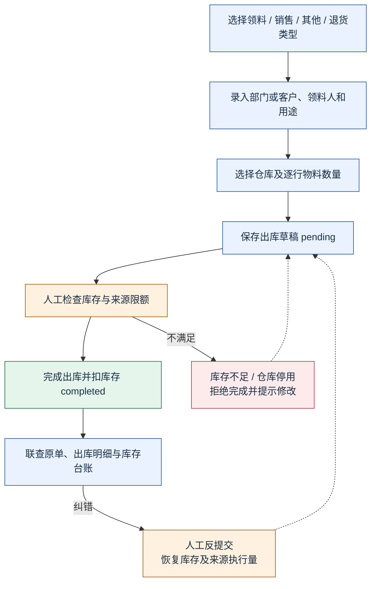

### 操作与口径

1. 普通“领料单”对应OutOrder，工单领料对应ProductionRequisition；菜单与单据模型不同，不能将两者画成一张单。
2. 库存判断按所选仓库进行，不能用全系统库存掩盖本仓不足。负库存能否放行由相应系统配置与业务校验决定。
3. 销售出库关联销售行时还要检查订单剩余可发量；采购退货检查来源入库可退量。数量与金额需要逐行合法且可追溯。
4. 同一张领料/其他出库明细可以对应不同合同/工程；报表按实际明细归集，不只看表头冗余字段。

### 核对来源

- [app/routes/out_order.py:1](https://github.com/SIX2090/wms/blob/21b97ce28ad0a72929381b89b1739d0c40b5b7ef/app/routes/out_order.py#L1)
- [app/models/documents.py:1](https://github.com/SIX2090/wms/blob/21b97ce28ad0a72929381b89b1739d0c40b5b7ef/app/models/documents.py#L1)
- [app/services/warehouse_stock_service.py:1](https://github.com/SIX2090/wms/blob/21b97ce28ad0a72929381b89b1739d0c40b5b7ef/app/services/warehouse_stock_service.py#L1)

## 09 销售订单、出库选单与履约

入口：销售管理 → 销售订单 / 销售出库选单 / 销售工作台。
库存影响：确认订单不实际扣库存；生成出库草稿占用可发量；出库完成扣库存。。

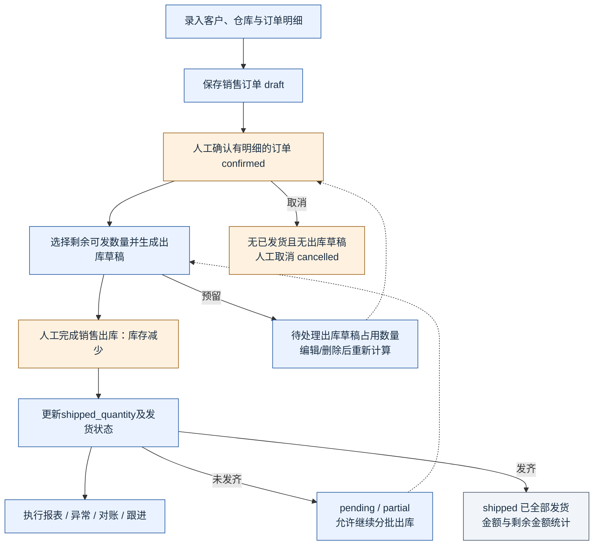

### 操作与口径

1. 销售订单有业务状态draft/confirmed以及独立发货状态pending/partial/shipped；实际路由还支持有条件的cancelled，不应只照旧注释画两态。
2. 可发量需同时考虑订单行剩余数量、待处理出库草稿和仓库可用库存；订单确认本身并不是库存扣减。
3. 订单选单、整单下推和直接销售出库是不同入口；有来源的销售出库保留source_sales_order_item_id并按行回写执行。
4. 对账与价格分析是查询/归集能力，不能据此宣称系统实现了收款核销、总账、税务或完整财务ERP。

### 核对来源

- [app/routes/sales.py:1](https://github.com/SIX2090/wms/blob/21b97ce28ad0a72929381b89b1739d0c40b5b7ef/app/routes/sales.py#L1)
- [app/routes/out_order.py:1](https://github.com/SIX2090/wms/blob/21b97ce28ad0a72929381b89b1739d0c40b5b7ef/app/routes/out_order.py#L1)
- [app/models/documents.py:1](https://github.com/SIX2090/wms/blob/21b97ce28ad0a72929381b89b1739d0c40b5b7ef/app/models/documents.py#L1)
- [app/app.py#sales_outbound_remaining_check:35215](https://github.com/SIX2090/wms/blob/21b97ce28ad0a72929381b89b1739d0c40b5b7ef/app/app.py#L35215)

## 10 销售退货入库

入口：销售业务关联退货 / 入库类型“销售退货入库”。
库存影响：完成退货入库增加库存；反提交退货减回库存；已退量由已完成退货聚合。。

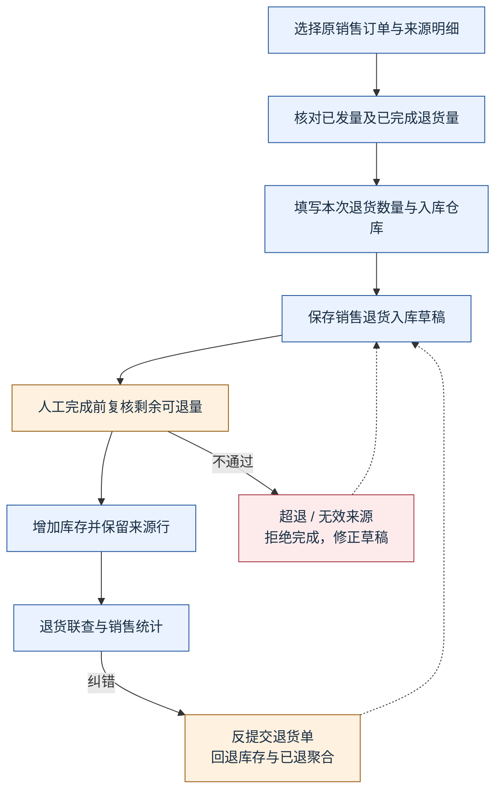

### 操作与口径

1. 限额按来源销售行计算：已发数量减去已完成退货入库聚合，不以待处理草稿替代已退事实。
2. 销售退货不把原订单shipped_quantity直接减回；已退量另做聚合，防止原发货事实被覆盖。
3. 历史无来源数据不会凭空推断归属；能否对无来源单据校验限额由实际路径和配置决定，图中不声称全部历史记录可自动匹配。

### 核对来源

- [app/routes/in_order.py:1](https://github.com/SIX2090/wms/blob/21b97ce28ad0a72929381b89b1739d0c40b5b7ef/app/routes/in_order.py#L1)
- [app/app.py#sales_return_remaining_check:35300](https://github.com/SIX2090/wms/blob/21b97ce28ad0a72929381b89b1739d0c40b5b7ef/app/app.py#L35300)
- [app/models/documents.py:1](https://github.com/SIX2090/wms/blob/21b97ce28ad0a72929381b89b1739d0c40b5b7ef/app/models/documents.py#L1)

## 11 采购退货出库

入口：采购管理 → 采购退货。
库存影响：完成退货出库扣库存；反提交恢复库存；不直接逆写原采购行预留计数。。

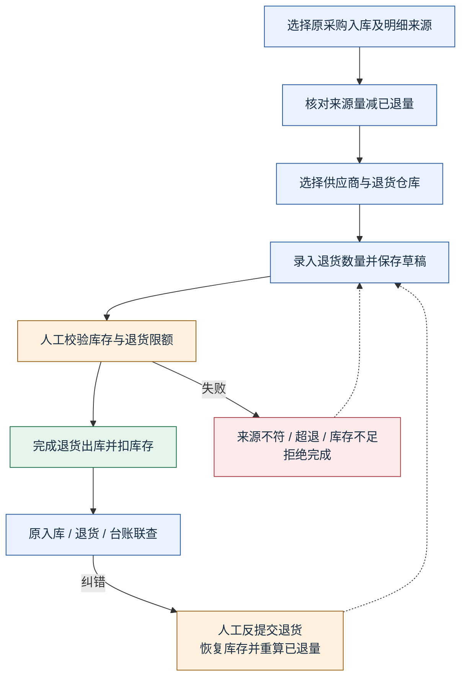

### 操作与口径

1. 采购退货复用OutOrder而非另建余额管道，记录source_in_order_id及source_in_order_item_id。
2. 来源约束和是否强制关联原入库受退货设置控制；限额为原入库行量减已完成退货聚合。
3. 退货只写库存增量与退货事实，不直接把采购订单received_quantity反向减回。

### 核对来源

- [app/routes/out_order.py:1](https://github.com/SIX2090/wms/blob/21b97ce28ad0a72929381b89b1739d0c40b5b7ef/app/routes/out_order.py#L1)
- [app/app.py#purchase_return_remaining_check:35387](https://github.com/SIX2090/wms/blob/21b97ce28ad0a72929381b89b1739d0c40b5b7ef/app/app.py#L35387)
- [app/app.py#validate_purchase_return_quantity:35368](https://github.com/SIX2090/wms/blob/21b97ce28ad0a72929381b89b1739d0c40b5b7ef/app/app.py#L35368)
- [app/models/documents.py:1](https://github.com/SIX2090/wms/blob/21b97ce28ad0a72929381b89b1739d0c40b5b7ef/app/models/documents.py#L1)

## 12 BOM表管理与按BOM工单领料

入口：基础资料 → BOM表管理；工单领料工具栏 → 按BOM领料。
库存影响：BOM及领料草稿不扣库存；工单领料完成扣库存，反提交恢复。。

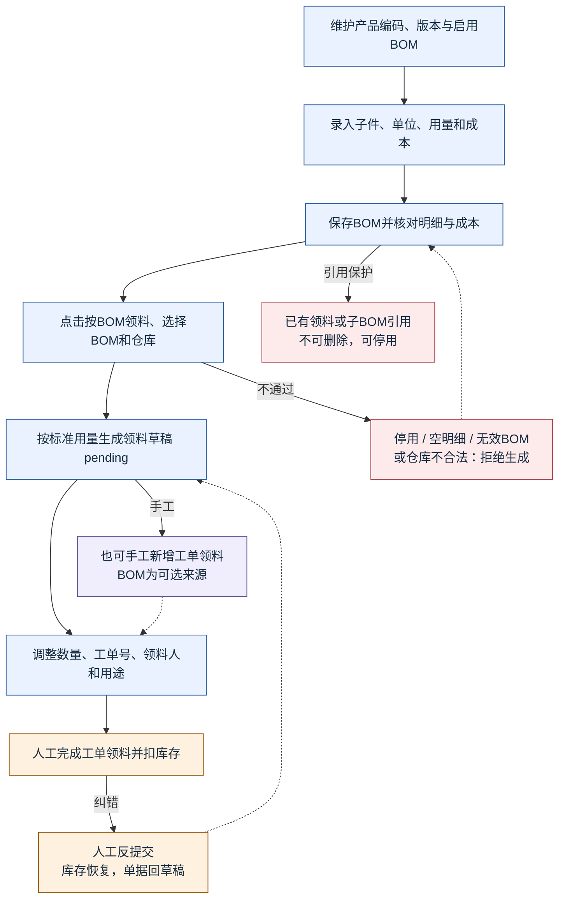

### 操作与口径

1. 按BOM领料选择窗口只提供启用BOM，可按编号、产品编码/名称/版本搜索；修改输入会清空旧选择ID。生成后自动打开草稿。
2. 标准用量带入后可人工修改，当前按钮没有生产数量倍乘输入；不要虚构自动多级展开、替代料、损耗率或生产计划。
3. 普通保存保留录入成本，包括0单价；重算成本按物料当前价格更新，两个动作的含义不同。
4. 工单领料与普通OutOrder领料是独立单据。生产成品入库需要另录产品入库，系统不会因领料完成自动生成完工入库。

### 核对来源

- [app/routes/bom.py:1](https://github.com/SIX2090/wms/blob/21b97ce28ad0a72929381b89b1739d0c40b5b7ef/app/routes/bom.py#L1)
- [app/routes/requisition.py:1](https://github.com/SIX2090/wms/blob/21b97ce28ad0a72929381b89b1739d0c40b5b7ef/app/routes/requisition.py#L1)
- [app/static/js/requisition-bom.js:1](https://github.com/SIX2090/wms/blob/21b97ce28ad0a72929381b89b1739d0c40b5b7ef/app/static/js/requisition-bom.js#L1)
- [app/templates/_requisition_bom_picker.html:1](https://github.com/SIX2090/wms/blob/21b97ce28ad0a72929381b89b1739d0c40b5b7ef/app/templates/_requisition_bom_picker.html#L1)

## 13 仓库间调拨及反提交

入口：库存管理 → 库存调拨。
库存影响：调出仓减少、调入仓增加；同一物料全系统总量不变。。

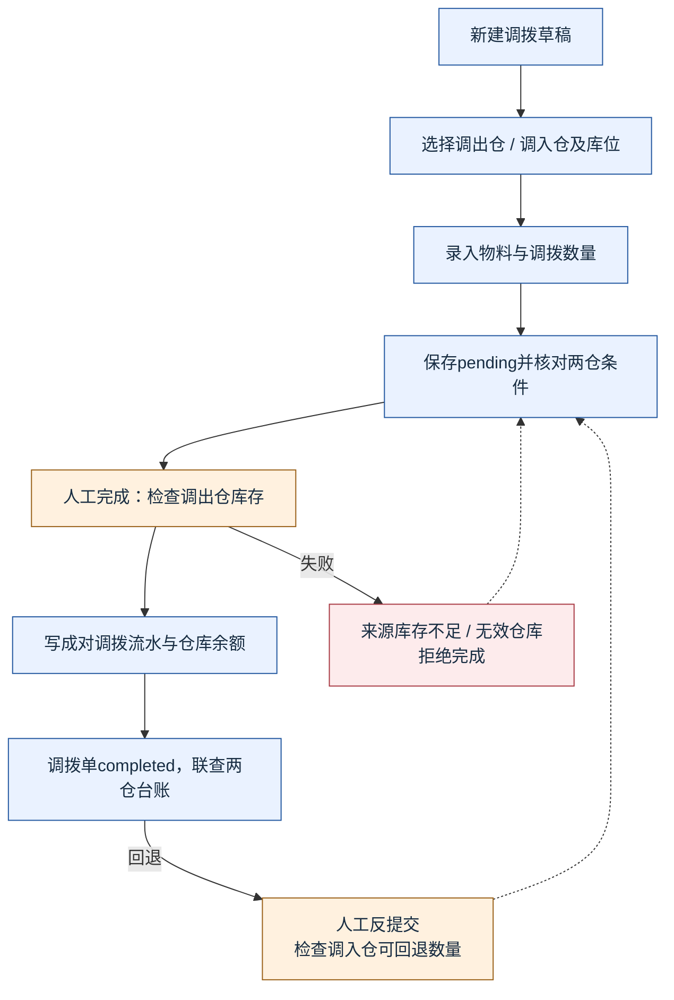

### 操作与口径

1. 调拨同时涉及两仓，不能只改全局material.stock，也不能只写一侧流水。开启库位时还要同步两侧库位余额。
2. 当前代码存在revert_transfer路由：已完成调拨可有条件反提交；需要检查目标仓现有可回退量，然后写反向成对流水。
3. 模型保留cancelled兼容状态，不因此假设页面一定提供独立作废按钮；能操作的状态转换以实际路由为准。

### 核对来源

- [app/routes/transfer.py:1](https://github.com/SIX2090/wms/blob/21b97ce28ad0a72929381b89b1739d0c40b5b7ef/app/routes/transfer.py#L1)
- [app/services/warehouse_stock_service.py#apply_transfer_pair:253](https://github.com/SIX2090/wms/blob/21b97ce28ad0a72929381b89b1739d0c40b5b7ef/app/services/warehouse_stock_service.py#L253)
- [app/models/documents.py:1](https://github.com/SIX2090/wms/blob/21b97ce28ad0a72929381b89b1739d0c40b5b7ef/app/models/documents.py#L1)

## 14 PC盘点、冻结快照与差异草稿

入口：库存管理 → 库存盘点。
库存影响：完成盘点本身不直接改库存；差异经调整草稿人工完成后记账。。

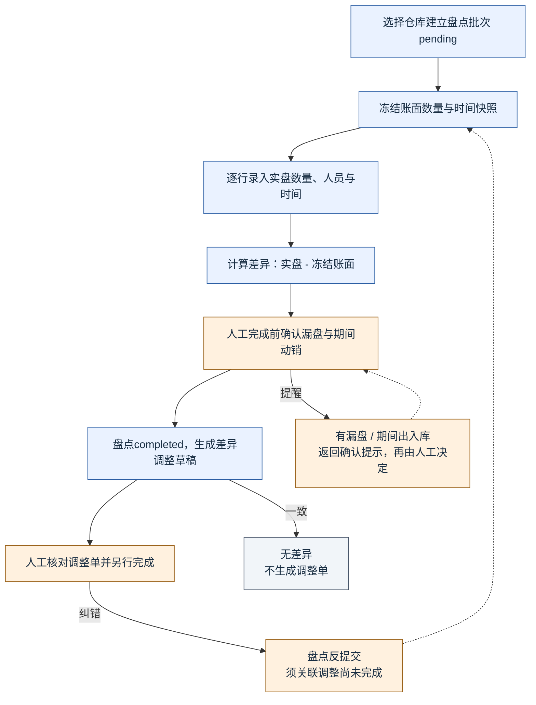

### 操作与口径

1. 未盘行不应当作实盘0，更不能自动产生全额盘亏。完成前会提示尚未盘点行并要求人工确认。
2. 冻结只是盘点计算基准，不代表系统锁死全部其他出入库；期间动销会提示，必须理解冻结口径与当前实物的区别。
3. 完成盘点调用_create_adjustment_drafts_from_check，生成库存调整草稿；图中明确把库存写入留在调整完成节点。
4. 已有完成的关联调整单时不能直接反提交盘点；先按下游调整规则处理，避免差异与库存事实脱节。

### 核对来源

- [app/routes/check.py:1](https://github.com/SIX2090/wms/blob/21b97ce28ad0a72929381b89b1739d0c40b5b7ef/app/routes/check.py#L1)
- [app/app.py#_create_adjustment_drafts_from_check:26763](https://github.com/SIX2090/wms/blob/21b97ce28ad0a72929381b89b1739d0c40b5b7ef/app/app.py#L26763)
- [app/models/documents.py:1](https://github.com/SIX2090/wms/blob/21b97ce28ad0a72929381b89b1739d0c40b5b7ef/app/models/documents.py#L1)

## 15 扫码盘点与PC批次协同

入口：手机手工盘点 / Android盘点；可选择PC未完成批次。
库存影响：记录扫码实盘与生成差异调整草稿；调整未完成前不改变库存。。

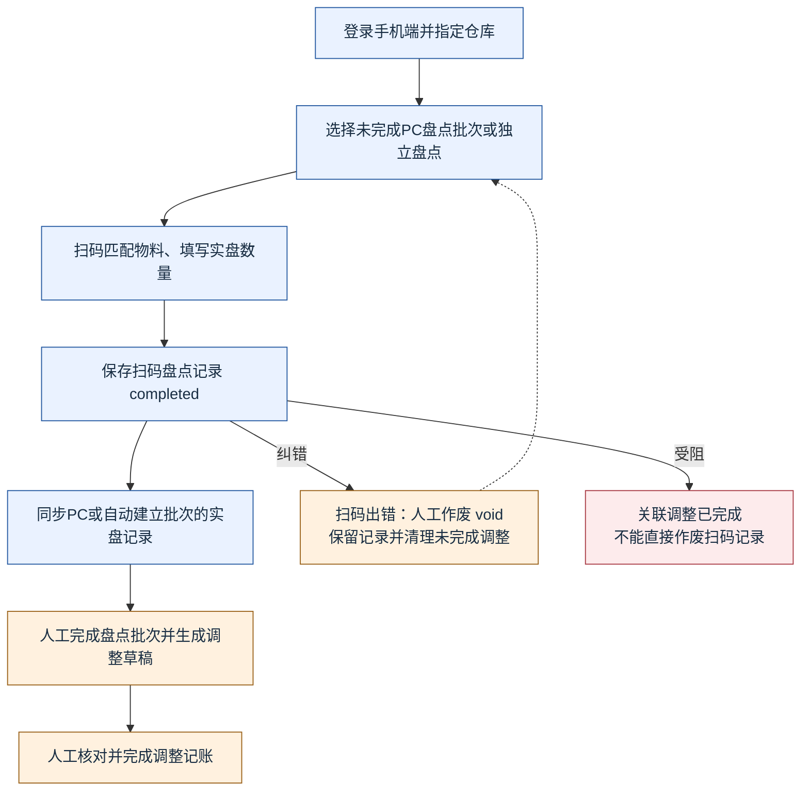

### 操作与口径

1. PC InventoryCheck与InventoryCheckScan是不同记录。扫码记录创建即可completed，不表示盘点批次或差异调整已完成。
2. 挂接PC批次时使用该批次的冻结账面快照；独立扫码盘点自动建立对应批次。当前H5与原生批量扫码保存后均等待批次人工完成，不立刻生成或完成调整。
3. 作废路径会检查关联调整单状态；允许时撤销批次行贡献并清理尚未提交的差异草稿，不能删除已记账事实来掩盖盘错。

### 核对来源

- [app/routes/mobile.py:1](https://github.com/SIX2090/wms/blob/21b97ce28ad0a72929381b89b1739d0c40b5b7ef/app/routes/mobile.py#L1)
- [app/routes/native_api.py:1](https://github.com/SIX2090/wms/blob/21b97ce28ad0a72929381b89b1739d0c40b5b7ef/app/routes/native_api.py#L1)
- [app/app.py#_void_check_scan:26970](https://github.com/SIX2090/wms/blob/21b97ce28ad0a72929381b89b1739d0c40b5b7ef/app/app.py#L26970)
- [app/models/documents.py:1](https://github.com/SIX2090/wms/blob/21b97ce28ad0a72929381b89b1739d0c40b5b7ef/app/models/documents.py#L1)

## 16 库存调整与盘盈盘亏

入口：库存管理 → 库存调整；盘点差异下推。
库存影响：盘盈正增量、盘亏负增量；反提交写相反增量恢复。。

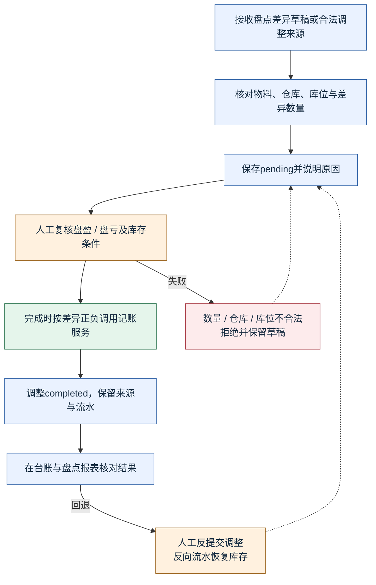

### 操作与口径

1. 调整不是直接覆盖material.stock；每条差异通过库存增量入口记账，并按库位开关维护相应余额。
2. 盘亏涉及出库条件，负库存及仓库口径必须与普通库存操作一致；有差异不表示能绕过校验。
3. 调整完成和盘点完成是两个独立人工节点；报表应能追溯到盘点来源和调整单。

### 核对来源

- [app/routes/adjustment.py:1](https://github.com/SIX2090/wms/blob/21b97ce28ad0a72929381b89b1739d0c40b5b7ef/app/routes/adjustment.py#L1)
- [app/services/warehouse_stock_service.py#apply_stock_delta:188](https://github.com/SIX2090/wms/blob/21b97ce28ad0a72929381b89b1739d0c40b5b7ef/app/services/warehouse_stock_service.py#L188)
- [app/models/documents.py:1](https://github.com/SIX2090/wms/blob/21b97ce28ad0a72929381b89b1739d0c40b5b7ef/app/models/documents.py#L1)

## 17 委外加工、发料、收料及进度

入口：库存管理 → 委外管理及发料/收料子单。
库存影响：发料完成扣原料；收料完成增收回物料；主单完结本身不等于库存变动。。

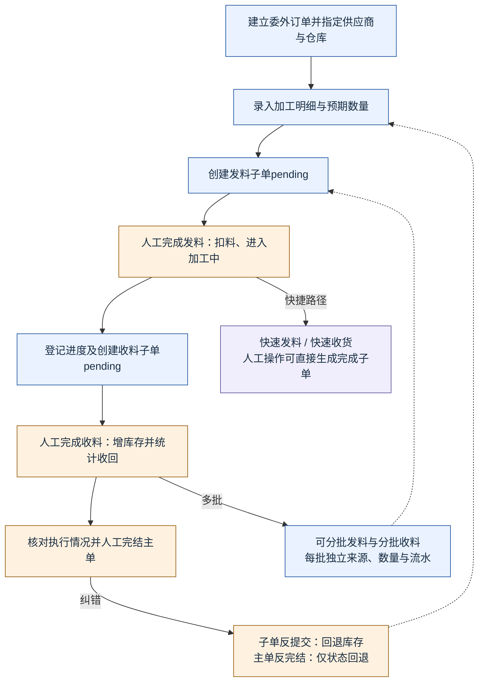

### 操作与口径

1. 委外主单、SubcontractIssue、SubcontractReceive和进度记录是独立对象；主单pending/processing/completed不代替每个子单的pending/completed。
2. 快速发料/收货是明确的人工库存动作，不能画成默认先存草稿。常规子单路径则分保存与完成两步。
3. 主单反完结按已完成子单情况回到processing或pending；子单反提交才执行库存对称回退。
4. 收料可记录数量、损耗/报废等字段，但图中不把它扩张为完整工序成本、委外应付或车间制造执行系统。

### 核对来源

- [app/routes/subcontract.py:1](https://github.com/SIX2090/wms/blob/21b97ce28ad0a72929381b89b1739d0c40b5b7ef/app/routes/subcontract.py#L1)
- [app/models/documents.py:1](https://github.com/SIX2090/wms/blob/21b97ce28ad0a72929381b89b1739d0c40b5b7ef/app/models/documents.py#L1)
- [app/services/warehouse_stock_service.py:1](https://github.com/SIX2090/wms/blob/21b97ce28ad0a72929381b89b1739d0c40b5b7ef/app/services/warehouse_stock_service.py#L1)

## 18 售后出库与独立纠错

入口：销售管理 → 售后出库。
库存影响：完成售后出库扣库存，反提交恢复；不等同销售退货入库。。

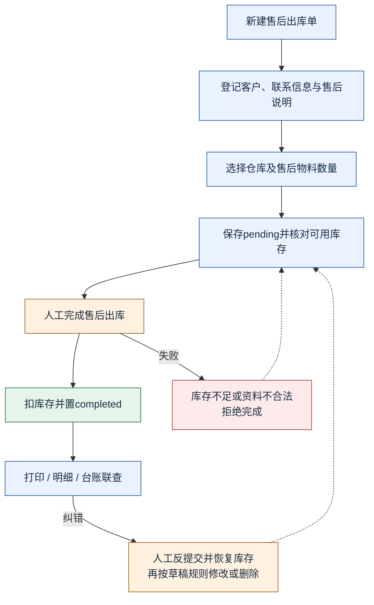

### 操作与口径

1. AfterSaleOutOrder是独立库存单据，不应混入普通销售订单发货状态，也不能把售后出库画成退回货物的入库。
2. 退货回仓需要销售退货入库流程；售后补件或替换件发出按售后出库登记。
3. 客户、仓库、物料数量与原因应核对清楚，完成后库存减少的事实在台账中可追溯。

### 核对来源

- [app/routes/after_sale_out.py:1](https://github.com/SIX2090/wms/blob/21b97ce28ad0a72929381b89b1739d0c40b5b7ef/app/routes/after_sale_out.py#L1)
- [app/models/documents.py:1](https://github.com/SIX2090/wms/blob/21b97ce28ad0a72929381b89b1739d0c40b5b7ef/app/models/documents.py#L1)

## 19 库存三账与多仓库查询

入口：库存报表 / 库存台账 / stock_query；库存变动服务。
库存影响：流水是库存事实；全局、仓库、库位是不同聚合粒度。。

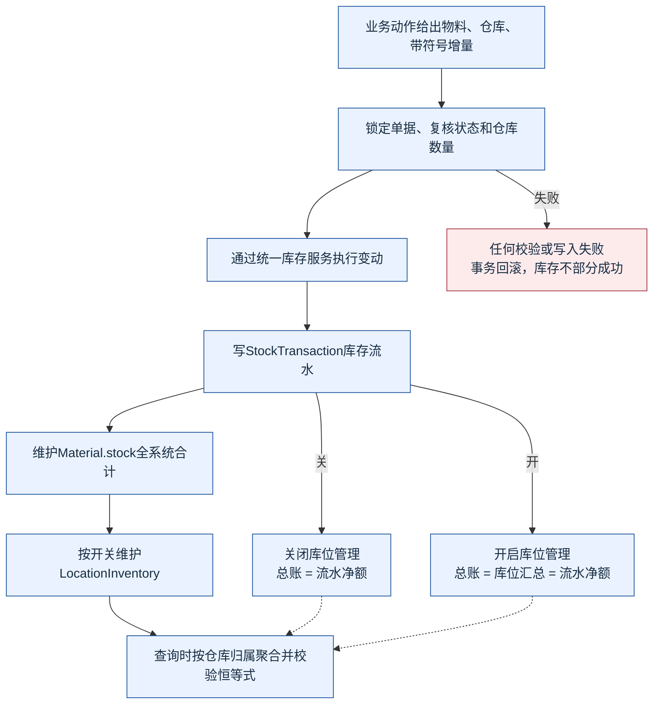

### 操作与口径

1. apply_stock_delta处理普通入出库，apply_transfer_pair处理调拨双边，apply_opening_balance处理建账流水/库位协同；不能把调拨当全局增减。
2. 当前关闭库位管理时库位账不更新，库存恒等式退化为Material.stock等于流水净额；开启后才要求三账全部相等。
3. 仓库查询必须指定仓库。历史空仓库/无法解析的归属不能随意分摊到任意仓库，需遵守历史兼容与未归属说明。
4. 反提交不是改写原流水，而是写对称增量并更新单据状态；汇总必须与明细全集一致。

### 核对来源

- [INVENTORY_TRUTH.md:1](https://github.com/SIX2090/wms/blob/21b97ce28ad0a72929381b89b1739d0c40b5b7ef/INVENTORY_TRUTH.md#L1)
- [app/services/warehouse_stock_service.py:1](https://github.com/SIX2090/wms/blob/21b97ce28ad0a72929381b89b1739d0c40b5b7ef/app/services/warehouse_stock_service.py#L1)
- [app/routes/stock_query.py:1](https://github.com/SIX2090/wms/blob/21b97ce28ad0a72929381b89b1739d0c40b5b7ef/app/routes/stock_query.py#L1)
- [app/models/inventory.py:1](https://github.com/SIX2090/wms/blob/21b97ce28ad0a72929381b89b1739d0c40b5b7ef/app/models/inventory.py#L1)

## 20 报表、筛选、汇总与预警

入口：报表中心、采购/销售报表、数据仪表盘、库存预警。
库存影响：查询、导出和打印不改变库存；报表读取库存事实与单据状态。。

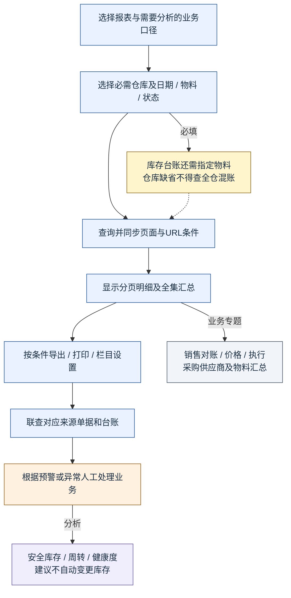

### 操作与口径

1. 通用报表当前定义14类，附录列出全部类型；另有采购专题、销售执行/价格/对账、工作台和仪表盘，不能用14代表系统全部报表页面。
2. 查询汇总基于满足条件的全集，列表基于分页；导出与打印要保留同一条件，不能把当前页行数当作总业务量。
3. 筛选可用快捷日期、关键词、状态、仓库等，清空条件必须保留业务要求的仓库；台账需结合物料查看期初、入、出和结存。
4. 预警与AI建议为分析输出，采购单、调拨、调整或出入库动作仍通过有权限的业务单据完成。

### 核对来源

- [app/routes/report.py:1](https://github.com/SIX2090/wms/blob/21b97ce28ad0a72929381b89b1739d0c40b5b7ef/app/routes/report.py#L1)
- [app/app.py#REPORT_DEFINITIONS:27425](https://github.com/SIX2090/wms/blob/21b97ce28ad0a72929381b89b1739d0c40b5b7ef/app/app.py#L27425)
- [app/routes/sales.py:1](https://github.com/SIX2090/wms/blob/21b97ce28ad0a72929381b89b1739d0c40b5b7ef/app/routes/sales.py#L1)
- [app/routes/inventory_alert.py:1](https://github.com/SIX2090/wms/blob/21b97ce28ad0a72929381b89b1739d0c40b5b7ef/app/routes/inventory_alert.py#L1)
- [app/templates/report_view.html:1](https://github.com/SIX2090/wms/blob/21b97ce28ad0a72929381b89b1739d0c40b5b7ef/app/templates/report_view.html#L1)

## 21 手机H5、Android与扫码录单

入口：手机扫码菜单 / Android APP / 移动API。
库存影响：批量草稿路径先不记账；传统快速扫码提交可直接完成，必须区分。。

```mermaid
flowchart TD
  n0["Web会话或Bearer登录并验证角色"]
  n1["选择入库 / 出库 / 盘点 / 查询模式"]
  n2["选择仓库、扫描或搜索物料"]
  n3["输入数量并检查模式与数据"]
  n4["按对应接口提交或保存批量草稿"]
  n5["人工确认草稿后记账并完成"]
  n6["手机联查记录或请求打印"]
  b0["批量扫码草稿<br/>pending：暂不动库存"]
  b1["传统快速扫码 / 部分原生提交<br/>人工提交即completed并记账"]
  b2["盘点模式<br/>走扫码盘点及调整专图"]
  n0 --> n1
  n1 --> n2
  n2 --> n3
  n3 --> n4
  n4 --> n5
  n5 --> n6
  n4 -->|批量草稿| b0
  b0 -.-> n5
  n4 -->|快速提交| b1
  b1 -.-> n6
  n2 -->|盘点| b2
  classDef data fill:#eaf2ff,stroke:#2358a0,color:#182d42
  class n0,n1,n2,n3,n4,n6,b0 data
  classDef human fill:#fff1df,stroke:#996017,color:#182d42
  class n5 human
  classDef stock fill:#e5f5eb,stroke:#206e46,color:#182d42
  class b1 stock
  classDef decision fill:#fff5cd,stroke:#8b671a,color:#182d42
  classDef exception fill:#fdebec,stroke:#a83943,color:#182d42
  classDef optional fill:#f0eefc,stroke:#65569a,color:#182d42
  class b2 optional
  classDef read fill:#f1f5f9,stroke:#475569,color:#182d42
```

### 操作与口径

1. mobile_scan_submit的入/出库路径可直接产生completed单据；mobile_scan_batch_draft与scan_draft_confirm则明确两阶段。图中不笼统宣传扫码都先草稿。
2. Android入库草稿、语音草稿与传统原生库存动作是不同端点；以页面按钮及调用路径判定是否即刻记账。
3. 移动权限在服务端校验，Bearer与Web会话是不同认证通道；失效、离线或识别多候选时应提示人工处理。
4. 二维码/条码查询与打印任务创建不等于库存提交；盘点的实际库存变化仍需走调整完成。

### 核对来源

- [app/routes/mobile.py:1](https://github.com/SIX2090/wms/blob/21b97ce28ad0a72929381b89b1739d0c40b5b7ef/app/routes/mobile.py#L1)
- [app/routes/native_api.py:1](https://github.com/SIX2090/wms/blob/21b97ce28ad0a72929381b89b1739d0c40b5b7ef/app/routes/native_api.py#L1)
- [app/templates/mobile_scan.html:1](https://github.com/SIX2090/wms/blob/21b97ce28ad0a72929381b89b1739d0c40b5b7ef/app/templates/mobile_scan.html#L1)
- [app/models/core.py:1](https://github.com/SIX2090/wms/blob/21b97ce28ad0a72929381b89b1739d0c40b5b7ef/app/models/core.py#L1)

## 22 导入、导出、粘贴与业务附件

入口：批量导入 / 各列表工具栏 / 单据粘贴导入 / 证据附件。
库存影响：导入落地方式由对象决定；期初导入可记账，BOM资料导入不记账。。

```mermaid
flowchart TD
  n0["选择对象与下载对应模板"]
  n1["准备列名、编码、单位和来源信息"]
  n2["上传文件或粘贴表格数据"]
  n3["校验格式、权限、行字段及重复项"]
  n4["按该对象规则保存资料或单据"]
  n5["查看新增 / 更新 / 跳过 / 错误反馈"]
  n6["回到列表核对并按业务流程处理"]
  b0["格式错误或无有效行<br/>返回中文问题，不当作成功"]
  b1["单据草稿需人工完成<br/>期初则按建账规则记账"]
  b2["附件绑定单据<br/>上传、查看、授权下载"]
  n0 --> n1
  n1 --> n2
  n2 --> n3
  n3 --> n4
  n4 --> n5
  n5 --> n6
  n3 -->|失败| b0
  b0 -.-> n1
  n4 -->|按类型| b1
  b1 -.-> n5
  n6 -->|证据| b2
  classDef data fill:#eaf2ff,stroke:#2358a0,color:#182d42
  class n0,n1,n2,n3,n4,n5,n6,b2 data
  classDef human fill:#fff1df,stroke:#996017,color:#182d42
  classDef stock fill:#e5f5eb,stroke:#206e46,color:#182d42
  classDef decision fill:#fff5cd,stroke:#8b671a,color:#182d42
  class b1 decision
  classDef exception fill:#fdebec,stroke:#a83943,color:#182d42
  class b0 exception
  classDef optional fill:#f0eefc,stroke:#65569a,color:#182d42
  classDef read fill:#f1f5f9,stroke:#475569,color:#182d42
```

### 操作与口径

1. “导入成功”不统一等于“业务完成”：BOM、资料、订单、库存单据、期初各有自己的落地语义，应按相应对象专图核对。
2. BOM导入先校验再创建，无有效行拒绝，同产品同版本多BOM拒绝含糊更新；重复物料保持最后行覆盖策略并警告。
3. 业务附件是证据与文件权限流程，不直接改变库存。支持情况以document_evidence路由及对应单据页面为准。
4. 导出按筛选全集形成文件，手工修改导出文件不会回写系统；回写必须再次走导入或编辑流程。

### 核对来源

- [app/routes/batch_import.py:1](https://github.com/SIX2090/wms/blob/21b97ce28ad0a72929381b89b1739d0c40b5b7ef/app/routes/batch_import.py#L1)
- [app/routes/export.py:1](https://github.com/SIX2090/wms/blob/21b97ce28ad0a72929381b89b1739d0c40b5b7ef/app/routes/export.py#L1)
- [app/routes/bom.py:1](https://github.com/SIX2090/wms/blob/21b97ce28ad0a72929381b89b1739d0c40b5b7ef/app/routes/bom.py#L1)
- [app/document_evidence.py:1](https://github.com/SIX2090/wms/blob/21b97ce28ad0a72929381b89b1739d0c40b5b7ef/app/document_evidence.py#L1)
- [app/templates/document_table_form.html:1](https://github.com/SIX2090/wms/blob/21b97ce28ad0a72929381b89b1739d0c40b5b7ef/app/templates/document_table_form.html#L1)

## 23 标签、条码与单据模板打印

入口：物料档案 / 标签打印 / 各单据打印 / Excel打印模板中心。
库存影响：标签、预览、下载与打印不记库存。。

```mermaid
flowchart TD
  n0["选择物料或业务单据"]
  n1["选择标签或单据/报表打印目标"]
  n2["选模板、字段与打印份数"]
  n3["读取已保存单据或查询结果"]
  n4["生成标签 / HTML / Excel打印文件"]
  n5["人工预览并选择打印方式"]
  n6["出纸或下载文件后核对输出"]
  b0["标签条码 / 物料档案<br/>按物料标识生成"]
  b1["路由到打印工作站<br/>任务队列走下一专图"]
  n0 --> n1
  n1 --> n2
  n2 --> n3
  n3 --> n4
  n4 --> n5
  n5 --> n6
  n2 -->|标签| b0
  b0 -.-> n4
  n4 -->|远程打印| b1
  classDef data fill:#eaf2ff,stroke:#2358a0,color:#182d42
  class n0,n1,n2,n3,n4,n6,b0 data
  classDef human fill:#fff1df,stroke:#996017,color:#182d42
  class n5 human
  classDef stock fill:#e5f5eb,stroke:#206e46,color:#182d42
  classDef decision fill:#fff5cd,stroke:#8b671a,color:#182d42
  classDef exception fill:#fdebec,stroke:#a83943,color:#182d42
  classDef optional fill:#f0eefc,stroke:#65569a,color:#182d42
  class b1 optional
  classDef read fill:#f1f5f9,stroke:#475569,color:#182d42
```

### 操作与口径

1. Excel打印模板中心维护目标类型、默认模板、上传模板与下载打印文件；单据与列表/报表模板的范围不同。
2. 打印文件应使用已保存单据或当前查询条件，不能把打印当保存，也不能把“打印设置”与“字段设置”混为同一功能。
3. 打印是否成功与业务完成独立；业务单已完成后打印失败只处理打印重试，不重复完成业务单据。

### 核对来源

- [app/routes/label.py:1](https://github.com/SIX2090/wms/blob/21b97ce28ad0a72929381b89b1739d0c40b5b7ef/app/routes/label.py#L1)
- [app/routes/label_barcode.py:1](https://github.com/SIX2090/wms/blob/21b97ce28ad0a72929381b89b1739d0c40b5b7ef/app/routes/label_barcode.py#L1)
- [app/routes/doc_print_excel.py:1](https://github.com/SIX2090/wms/blob/21b97ce28ad0a72929381b89b1739d0c40b5b7ef/app/routes/doc_print_excel.py#L1)
- [app/routes/print_template_center.py:1](https://github.com/SIX2090/wms/blob/21b97ce28ad0a72929381b89b1739d0c40b5b7ef/app/routes/print_template_center.py#L1)
- [app/models/print.py:1](https://github.com/SIX2090/wms/blob/21b97ce28ad0a72929381b89b1739d0c40b5b7ef/app/models/print.py#L1)

## 24 打印路由、工作站与失败重试

入口：系统管理 → 打印工作台路由 / 打印告警。
库存影响：任务状态pending/printing/done/failed，与单据库存状态分离。。

```mermaid
flowchart TD
  n0["配置工作站、打印机和路由规则"]
  n1["单据发起打印请求并验证目标"]
  n2["创建PrintJob pending"]
  n3["工作站心跳并领取任务 printing"]
  n4["本地代理调用打印服务出纸"]
  n5["上报done或failed及错误说明"]
  n6["查看告警、修复设备并按规则重试"]
  b0["设备离线 / Spooler异常<br/>中文指引与失败回报"]
  b1["认领超时 / 连接中断<br/>按队列规则回收重试"]
  n0 --> n1
  n1 --> n2
  n2 --> n3
  n3 --> n4
  n4 --> n5
  n5 --> n6
  n4 -->|失败| b0
  b0 -.-> n6
  n3 -->|超时| b1
  b1 -.-> n2
  classDef data fill:#eaf2ff,stroke:#2358a0,color:#182d42
  class n0,n1,n2,n3,n4,n5,n6 data
  classDef human fill:#fff1df,stroke:#996017,color:#182d42
  classDef stock fill:#e5f5eb,stroke:#206e46,color:#182d42
  classDef decision fill:#fff5cd,stroke:#8b671a,color:#182d42
  classDef exception fill:#fdebec,stroke:#a83943,color:#182d42
  class b0 exception
  classDef optional fill:#f0eefc,stroke:#65569a,color:#182d42
  class b1 optional
  classDef read fill:#f1f5f9,stroke:#475569,color:#182d42
```

### 操作与口径

1. 路由依据工作站/设备/仓库等规则匹配目标，代理只领取授权范围的任务，不能把网页浏览器当作所有远程打印的实际执行端。
2. 任务真实状态为pending→printing→done/failed；done表示任务结果，不能据此改写库存单据状态。
3. 数据库忙、打印代理心跳及设备故障有独立降级路径；重试只重试打印任务，不重复出入库。

### 核对来源

- [app/routes/print_queue.py:1](https://github.com/SIX2090/wms/blob/21b97ce28ad0a72929381b89b1739d0c40b5b7ef/app/routes/print_queue.py#L1)
- [app/routes/print_routing.py:1](https://github.com/SIX2090/wms/blob/21b97ce28ad0a72929381b89b1739d0c40b5b7ef/app/routes/print_routing.py#L1)
- [app/routes/print_alerts.py:1](https://github.com/SIX2090/wms/blob/21b97ce28ad0a72929381b89b1739d0c40b5b7ef/app/routes/print_alerts.py#L1)
- [app/models/print.py:1](https://github.com/SIX2090/wms/blob/21b97ce28ad0a72929381b89b1739d0c40b5b7ef/app/models/print.py#L1)

## 25 AI单据OCR、匹配与人工草稿确认

入口：单据OCR识别 / AI文档工作流 / 微信送货通知识别。
库存影响：识别与建议不动库存；用户确认后最多生成草稿，完成仍走人工业务页。。

```mermaid
flowchart TD
  n0["用户上传图片、文件或输入通知"]
  n1["检查文件、角色、灰度与能力开关"]
  n2["预处理并调用OCR/识别服务"]
  n3["提取表头、物料、数量与来源候选"]
  n4["核对匹配、置信度与必填字段"]
  n5["人工确认类型、明细与生成草稿"]
  n6["跳转业务单页再由人工完成"]
  b0["失败 / 低置信度 / 多候选<br/>人工补录或回退任务"]
  b1["幂等令牌与操作审计<br/>同次确认不能重复建草稿"]
  n0 --> n1
  n1 --> n2
  n2 --> n3
  n3 --> n4
  n4 --> n5
  n5 --> n6
  n3 -->|不确定| b0
  b0 -.-> n4
  n5 -->|保护| b1
  b1 -.-> n6
  classDef data fill:#eaf2ff,stroke:#2358a0,color:#182d42
  class n0,n1,n2,n3,n4,b1 data
  classDef human fill:#fff1df,stroke:#996017,color:#182d42
  class n5,n6 human
  classDef stock fill:#e5f5eb,stroke:#206e46,color:#182d42
  classDef decision fill:#fff5cd,stroke:#8b671a,color:#182d42
  classDef exception fill:#fdebec,stroke:#a83943,color:#182d42
  class b0 exception
  classDef optional fill:#f0eefc,stroke:#65569a,color:#182d42
  classDef read fill:#f1f5f9,stroke:#475569,color:#182d42
```

### 操作与口径

1. 供应商发货通知应识别为采购收货/送货入库草稿，不默认生成采购申请；业务类型必须在确认页明确。
2. OCR处理任务状态、字段确认状态、草稿状态是不同层次；某个识别任务完成不等于库存单据完成。
3. AI不能通过模型工具自动执行审核、提交、完成、作废、删除或改库存；角色、开关、灰度及人工确认都在服务端执行。
4. 模型服务、密钥和图片质量可能限制识别；系统必须明确提示不确定，不用虚构物料、数量或处理结果来代替人工判断。

### 核对来源

- [AI_PERMISSION_MATRIX.md:1](https://github.com/SIX2090/wms/blob/21b97ce28ad0a72929381b89b1739d0c40b5b7ef/AI_PERMISSION_MATRIX.md#L1)
- [app/ai/documents/extractor.py:1](https://github.com/SIX2090/wms/blob/21b97ce28ad0a72929381b89b1739d0c40b5b7ef/app/ai/documents/extractor.py#L1)
- [app/ai/documents/document_confirmation.py:1](https://github.com/SIX2090/wms/blob/21b97ce28ad0a72929381b89b1739d0c40b5b7ef/app/ai/documents/document_confirmation.py#L1)
- [app/ai/documents/provider_router.py:1](https://github.com/SIX2090/wms/blob/21b97ce28ad0a72929381b89b1739d0c40b5b7ef/app/ai/documents/provider_router.py#L1)
- [app/models/ai.py:1](https://github.com/SIX2090/wms/blob/21b97ce28ad0a72929381b89b1739d0c40b5b7ef/app/models/ai.py#L1)

## 26 AI查询、经营分析与Agent工作台

入口：AI助手、采购/销售/仓库工作台、巡检、补货、健康度等。
库存影响：查询与建议只读；建议转草稿需人工确认；消息话术不默认自动发送。。

```mermaid
flowchart TD
  n0["用户提出查询或运行分析任务"]
  n1["校验账号能力、开关与灰度范围"]
  n2["读取库存/订单/业务事实及上下文"]
  n3["运行查询、规则分析或Agent步骤"]
  n4["生成结果、异常、补货或跟进建议"]
  n5["人工查看证据、处理回退与确认动作"]
  n6["记录运行审计、反馈、质量和验收"]
  b0["只读结果 / 经营指标<br/>直接展示并注明范围"]
  b1["需要草稿或对外发送<br/>先到人工确认业务页"]
  b2["预算 / 权限 / 依赖失败<br/>停止或回退，不编造结果"]
  n0 --> n1
  n1 --> n2
  n2 --> n3
  n3 --> n4
  n4 --> n5
  n5 --> n6
  n4 -->|查询| b0
  b0 -.-> n6
  n4 -->|动作| b1
  b1 -.-> n5
  n3 -->|失败| b2
  b2 -.-> n6
  classDef data fill:#eaf2ff,stroke:#2358a0,color:#182d42
  class n0,n1,n2,n3,n4,n6 data
  classDef human fill:#fff1df,stroke:#996017,color:#182d42
  class n5,b1 human
  classDef stock fill:#e5f5eb,stroke:#206e46,color:#182d42
  classDef decision fill:#fff5cd,stroke:#8b671a,color:#182d42
  classDef exception fill:#fdebec,stroke:#a83943,color:#182d42
  class b2 exception
  classDef optional fill:#f0eefc,stroke:#65569a,color:#182d42
  classDef read fill:#f1f5f9,stroke:#475569,color:#182d42
  class b0 read
```

### 操作与口径

1. 已存在补货、安全库存、周转/库存健康、需求预测、供应商评估、库位推荐和采购/销售履约跟进等页面；可用性还取决于模型配置和功能开关。
2. Agent任务/步骤、巡检告警、人工回退、运行审计、质量运营、上线预检与七日验收是AI支撑流程，不是新的库存账务链。
3. 采购或销售跟进话术由人决定是否发送，Agent运行成功不代表已经通知供应商或客户。
4. 图中按已注册工具与实际模块描述能力，不将开发台账中规划/未开放项宣传成默认全部可用。

### 核对来源

- [app/ai/tools/registry.py:1](https://github.com/SIX2090/wms/blob/21b97ce28ad0a72929381b89b1739d0c40b5b7ef/app/ai/tools/registry.py#L1)
- [app/ai/policies.py:1](https://github.com/SIX2090/wms/blob/21b97ce28ad0a72929381b89b1739d0c40b5b7ef/app/ai/policies.py#L1)
- [app/ai/agents/framework.py:1](https://github.com/SIX2090/wms/blob/21b97ce28ad0a72929381b89b1739d0c40b5b7ef/app/ai/agents/framework.py#L1)
- [app/ai/ops/monitor.py:1](https://github.com/SIX2090/wms/blob/21b97ce28ad0a72929381b89b1739d0c40b5b7ef/app/ai/ops/monitor.py#L1)
- [app/ai/ops/business_quality.py:1](https://github.com/SIX2090/wms/blob/21b97ce28ad0a72929381b89b1739d0c40b5b7ef/app/ai/ops/business_quality.py#L1)
- [AI_PERMISSION_MATRIX.md:1](https://github.com/SIX2090/wms/blob/21b97ce28ad0a72929381b89b1739d0c40b5b7ef/AI_PERMISSION_MATRIX.md#L1)

## 27 用户权限、审批与操作审计

入口：登录 / 用户管理 / 审批中心 / 操作审计。
库存影响：权限和审计决定谁能操作，不直接替代库存事务或业务完成。。

```mermaid
flowchart TD
  n0["用户登录并校验有效身份"]
  n1["读取角色及只读/业务权限"]
  n2["页面展示可用菜单与按钮"]
  n3["请求到服务端再次校验权限"]
  n4["业务动作同时校验单据状态与数据"]
  n5["写业务结果及对应操作/运行记录"]
  n6["在审批或操作审计中查询追溯"]
  b0["未登录 / 无权限 / 会话失效<br/>拒绝或转登录"]
  b1["AI权限另叠加能力与灰度<br/>高风险动作不交给模型"]
  n0 --> n1
  n1 --> n2
  n2 --> n3
  n3 --> n4
  n4 --> n5
  n5 --> n6
  n3 -->|不允许| b0
  b0 -.-> n0
  n2 -->|AI| b1
  b1 -.-> n3
  classDef data fill:#eaf2ff,stroke:#2358a0,color:#182d42
  class n0,n1,n2,n3,n4,n5,n6 data
  classDef human fill:#fff1df,stroke:#996017,color:#182d42
  classDef stock fill:#e5f5eb,stroke:#206e46,color:#182d42
  classDef decision fill:#fff5cd,stroke:#8b671a,color:#182d42
  classDef exception fill:#fdebec,stroke:#a83943,color:#182d42
  class b0 exception
  classDef optional fill:#f0eefc,stroke:#65569a,color:#182d42
  class b1 optional
  classDef read fill:#f1f5f9,stroke:#475569,color:#182d42
```

### 操作与口径

1. 管理员具有广泛管理权限；仓库、采购、销售、生产及只读账号按服务端规则限制动作。菜单可见不等于拥有写权限。
2. 审批中心主要处理采购申请；主出入库仍是pending→completed的一跳人工流转，当前不强加多人审核岗。
3. 操作审计、库存流水、AI审计和打印记录各有用途；业务追溯不能只看单一日志。
4. 本图只解释权限使用，不执行账号角色、凭证、密码或密钥变更。

### 核对来源

- [app/routes/user_auth.py:1](https://github.com/SIX2090/wms/blob/21b97ce28ad0a72929381b89b1739d0c40b5b7ef/app/routes/user_auth.py#L1)
- [app/routes/approval.py:1](https://github.com/SIX2090/wms/blob/21b97ce28ad0a72929381b89b1739d0c40b5b7ef/app/routes/approval.py#L1)
- [app/utils.py:1](https://github.com/SIX2090/wms/blob/21b97ce28ad0a72929381b89b1739d0c40b5b7ef/app/utils.py#L1)
- [app/models/core.py:1](https://github.com/SIX2090/wms/blob/21b97ce28ad0a72929381b89b1739d0c40b5b7ef/app/models/core.py#L1)
- [app/models/ai.py:1](https://github.com/SIX2090/wms/blob/21b97ce28ad0a72929381b89b1739d0c40b5b7ef/app/models/ai.py#L1)

## 28 微信分享、定时发送与重发

入口：系统管理 → 微信分享；业务工具栏 → 智能分享。
库存影响：查询结果与图片发送不动库存；对外发送与建议展示是两个动作。。

```mermaid
flowchart TD
  n0["有权限人员配置分享目标与内容"]
  n1["选择单据/报表及筛选范围"]
  n2["生成摘要、图片或分享内容"]
  n3["预览并明确授权立即或定时发送"]
  n4["执行发送任务并记录结果"]
  n5["查看发送日志与失败原因"]
  n6["必要时由人重发或调整配置"]
  b0["外部服务 / 网络 / 权限失败<br/>记录失败，等待人工处理"]
  b1["已配置定时计划<br/>调度器按计划执行"]
  n0 --> n1
  n1 --> n2
  n2 --> n3
  n3 --> n4
  n4 --> n5
  n5 --> n6
  n4 -->|失败| b0
  b0 -.-> n5
  n3 -->|定时| b1
  b1 -.-> n4
  classDef data fill:#eaf2ff,stroke:#2358a0,color:#182d42
  class n0,n1,n2,n3,n4,n5,n6 data
  classDef human fill:#fff1df,stroke:#996017,color:#182d42
  classDef stock fill:#e5f5eb,stroke:#206e46,color:#182d42
  classDef decision fill:#fff5cd,stroke:#8b671a,color:#182d42
  classDef exception fill:#fdebec,stroke:#a83943,color:#182d42
  class b0 exception
  classDef optional fill:#f0eefc,stroke:#65569a,color:#182d42
  class b1 optional
  classDef read fill:#f1f5f9,stroke:#475569,color:#182d42
```

### 操作与口径

1. 微信分享存在配置、立即运行、日志、重发和图片下载等流程；定时发送需要既有明确配置与授权。
2. AI“给出跟进话术”不等于调用分享发送；对外消息属于另一条需用户控制的链。
3. 分享按单据或查询范围生成内容，不应为了发送而重复完成单据。敏感业务内容须由操作员核对接收目标。

### 核对来源

- [app/routes/wechat_share.py:1](https://github.com/SIX2090/wms/blob/21b97ce28ad0a72929381b89b1739d0c40b5b7ef/app/routes/wechat_share.py#L1)
- [app/models/wechat.py:1](https://github.com/SIX2090/wms/blob/21b97ce28ad0a72929381b89b1739d0c40b5b7ef/app/models/wechat.py#L1)
- [app/notifications.py:1](https://github.com/SIX2090/wms/blob/21b97ce28ad0a72929381b89b1739d0c40b5b7ef/app/notifications.py#L1)

## 29 数据备份、保留与停机恢复

入口：系统管理 → 数据备份；后台每日备份调度。
库存影响：备份读取一致性快照；恢复会替换数据库，页面在线恢复已禁用。。

```mermaid
flowchart TD
  n0["生产服务启动并注册备份调度"]
  n1["按配置时间触发每日在线备份"]
  n2["sqlite在线backup复制一致性快照"]
  n3["检查备份完整性并记录结果"]
  n4["清理到期auto_daily备份"]
  n5["人工下载/保存需要的备份副本"]
  n6["恢复必须走停机维护与复核流程"]
  b0["手动创建备份<br/>单独文件目录与列表"]
  b1["完整性检查失败<br/>丢弃坏备份并报告错误"]
  b2["网页恢复请求<br/>固定拒绝403"]
  n0 --> n1
  n1 --> n2
  n2 --> n3
  n3 --> n4
  n4 --> n5
  n5 --> n6
  n1 -->|手动| b0
  b0 -.-> n2
  n3 -->|失败| b1
  n6 -->|在线恢复| b2
  classDef data fill:#eaf2ff,stroke:#2358a0,color:#182d42
  class n0,n1,n2,n3,n4,n6 data
  classDef human fill:#fff1df,stroke:#996017,color:#182d42
  class n5 human
  classDef stock fill:#e5f5eb,stroke:#206e46,color:#182d42
  classDef decision fill:#fff5cd,stroke:#8b671a,color:#182d42
  classDef exception fill:#fdebec,stroke:#a83943,color:#182d42
  class b1,b2 exception
  classDef optional fill:#f0eefc,stroke:#65569a,color:#182d42
  class b0 optional
  classDef read fill:#f1f5f9,stroke:#475569,color:#182d42
```

### 操作与口径

1. 每日备份默认02:00、保留30天、目录C:\wms_backups；实际值可由AUTO_BACKUP_TIME、BACKUP_RETENTION_DAYS和WMS_BACKUP_DIR配置覆盖。
2. 保留清理仅针对auto_daily_*.db，不自动清理更新前和其他手动文件；不要把“保留30天”扩大为所有备份类型。
3. 手动备份列表与每日备份目录是不同管理范围。启动、更新前备份也有独立路径，不能只凭页面列表判断每日备份是否存在。
4. restore_backup路由固定403，恢复必须停机、保护现有库、验证备份、替换后重启并核对数据；本次任务未执行恢复。

### 核对来源

- [app/backup_scheduler.py:1](https://github.com/SIX2090/wms/blob/21b97ce28ad0a72929381b89b1739d0c40b5b7ef/app/backup_scheduler.py#L1)
- [app/routes/backup.py:1](https://github.com/SIX2090/wms/blob/21b97ce28ad0a72929381b89b1739d0c40b5b7ef/app/routes/backup.py#L1)
- [app/startup_check.py:1](https://github.com/SIX2090/wms/blob/21b97ce28ad0a72929381b89b1739d0c40b5b7ef/app/startup_check.py#L1)
- [app/run_server.py:1](https://github.com/SIX2090/wms/blob/21b97ce28ad0a72929381b89b1739d0c40b5b7ef/app/run_server.py#L1)

## 30 GitHub更新、启动与生产生效

入口：update_from_github.bat / start_wms_offline.bat / run_server.py。
库存影响：代码更新本身不等于业务记账；启动可能按配置检查或迁移数据库。。

```mermaid
flowchart TD
  n0["确认main基线与最新CI状态"]
  n1["保护本地改动、确认更新前备份"]
  n2["从GitHub拉取main并核对提交"]
  n3["核对依赖、配置与迁移开关"]
  n4["启动或重启Windows WMS服务"]
  n5["检查版本SHA、数据库与HTTP健康"]
  n6["打开实际页面验证新功能生效"]
  b0["网络 / 认证 / 本地冲突<br/>提示并保留现有可运行版本"]
  b1["启动自动更新为可选开关<br/>默认关闭，可环境强制跳过"]
  b2["模板与静态缓存需核对<br/>只修改文件不保证已生效"]
  n0 --> n1
  n1 --> n2
  n2 --> n3
  n3 --> n4
  n4 --> n5
  n5 --> n6
  n2 -->|失败| b0
  b0 -.-> n1
  n3 -->|可选| b1
  b1 -.-> n4
  n5 -->|生效| b2
  b2 -.-> n6
  classDef data fill:#eaf2ff,stroke:#2358a0,color:#182d42
  class n0,n1,n2,n3,n4,n5,n6 data
  classDef human fill:#fff1df,stroke:#996017,color:#182d42
  class b2 human
  classDef stock fill:#e5f5eb,stroke:#206e46,color:#182d42
  classDef decision fill:#fff5cd,stroke:#8b671a,color:#182d42
  classDef exception fill:#fdebec,stroke:#a83943,color:#182d42
  class b0 exception
  classDef optional fill:#f0eefc,stroke:#65569a,color:#182d42
  class b1 optional
  classDef read fill:#f1f5f9,stroke:#475569,color:#182d42
```

### 操作与口径

1. 不同更新入口对脏工作区的行为不同：一键更新脚本可拒绝本地未提交改动，启动自动更新有自己的策略；不能假设本地文件总能被安全覆盖。
2. 仓库规则要求只在main工作，先确认三个门禁工作流最新main运行成功，再独立提交/推送，核对本地与origin/main SHA一致。
3. Windows服务通过Waitress运行；启动日志显示代码SHA、配置检查和数据库检查。模板改动需生产重启，浏览器核对实际加载结果。
4. 文档、流程图和代码不是生产操作授权。本次仅制作资料，不执行业务提交、备份恢复、账号改动或库存调整。

### 核对来源

- [update_from_github.bat:1](https://github.com/SIX2090/wms/blob/21b97ce28ad0a72929381b89b1739d0c40b5b7ef/update_from_github.bat#L1)
- [app/auto_update.py:1](https://github.com/SIX2090/wms/blob/21b97ce28ad0a72929381b89b1739d0c40b5b7ef/app/auto_update.py#L1)
- [app/run_server.py:1](https://github.com/SIX2090/wms/blob/21b97ce28ad0a72929381b89b1739d0c40b5b7ef/app/run_server.py#L1)
- [app/startup_check.py:1](https://github.com/SIX2090/wms/blob/21b97ce28ad0a72929381b89b1739d0c40b5b7ef/app/startup_check.py#L1)
- [AGENTS.md:1](https://github.com/SIX2090/wms/blob/21b97ce28ad0a72929381b89b1739d0c40b5b7ef/AGENTS.md#L1)

## 附录A：单据状态与库存影响

| 对象 | 状态 | 回退 | 库存 |
|---|---|---|---|
| 入库 / 出库 | pending → completed | 反提交回pending；入库有有效下游时阻止 | 入库+，出库-；反提交对称 |
| 采购申请 | pending → approved / rejected；approved → completed | approved/completed可反审，无下游采购单才放行 | 不记库存 |
| 采购订单 | pending / partial / completed / closed | 关闭pending/partial；重开按已完成入库量重算 | 订单不记库存，完成入库记账 |
| 销售订单 | draft → confirmed；有条件cancelled | 发货另有pending / partial / shipped | 确认/取消不扣库存，完成出库才扣 |
| BOM | active / inactive | 引用后不删，可停用；生成领料草稿 | 不记库存 |
| 工单领料 | pending → completed | 实际代码支持反提交回pending | 完成扣库存，反提交恢复 |
| 调拨 | pending → completed | 实际代码支持反提交；cancelled为兼容态 | 两仓相反变动，全局不变 |
| PC盘点 | pending → completed | 关联调整未完成时可反提交 | 不直接记库存，生成调整草稿 |
| 扫码盘点 | 创建completed；可有条件void | 调整已完成不能直接作废 | 实盘记录不代替调整记账 |
| 调整 | pending → completed | 可反提交；cancelled为兼容态 | 按差异正负记账与对称回退 |
| 期初库存 | active | 数量差额；删除逐行回冲 | 保存/编辑即按差额记账 |
| 售后出库 | pending → completed | 反提交回pending | 完成扣库存，反提交恢复 |
| 委外主单 | pending / processing / completed；兼容cancelled | 主单反完结按子单重算状态 | 主单完结本身不记库存 |
| 委外发料/收料 | pending → completed | 子单支持反提交 | 发料-，收料+；快捷人工路径可直接完成 |
| 打印任务 | pending → printing → done / failed | 超时回收/重试依队列规则 | 不记库存 |
| AI识别/Agent | 识别状态、字段确认、运行状态各自独立 | 受权限/开关/灰度/人工确认约束 | 建议/识别不记库存，确认最多建草稿 |

## 附录B：通用报表类型

- 库存报表：`/report/view/inventory`
- 库存经营分析：`/report/view/inventory_analysis`
- 全部入库明细报表：`/report/view/in_detail`
- 领料明细报表：`/report/view/out_detail`
- 出入库汇总报表：`/report/view/summary`
- 盘点报表：`/report/view/check`
- 库存台账：`/report/view/ledger`
- 仓库月报表：`/report/view/warehouse_monthly`
- 委外加工报表：`/report/view/subcontract`
- 工单领料报表：`/report/view/requisition`
- 采购订单执行统计表：`/report/view/purchase_order_execution`
- 供应商采购汇总表：`/report/view/supplier_purchase_summary`
- 物料采购汇总表：`/report/view/material_purchase_summary`
- 采购价格分析表：`/report/view/purchase_price_analysis`

## 附录C：完整菜单清点

- 首页：`/`
- 我的资料：`/profile/edit`
- 下载扫码APP：`{{ url_for('mobile_app_download') }}`
- 手工入库：`{{ url_for('mobile_scan', mode='in') }}`
- 手工出库：`{{ url_for('mobile_scan', mode='out') }}`
- 手工盘点：`{{ url_for('mobile_scan', mode='check') }}`
- 手工查询：`{{ url_for('mobile_scan', mode='query') }}`
- 采购申请：`/purchase_request/add`
- 采购订单：`/purchase_order/add`
- 采购入库：`/in_order/add`
- 采购退货：`/out_order/add?type=purchase_return`
- 采购申请列表：`/purchase_request`
- 采购订单列表：`/purchase_order?view=list`
- 采购入库明细表：`/in_order?type=purchase_in`
- 供应商管理：`/supplier`
- 采购报表：`/purchase_report`
- 采购订单执行统计表：`/report/view/purchase_order_execution`
- 供应商采购汇总表：`/report/view/supplier_purchase_summary`
- 物料采购汇总表：`/report/view/material_purchase_summary`
- 采购价格分析表：`/report/view/purchase_price_analysis`
- 全部入库明细报表：`/report/view/in_detail`
- 补货建议（安全库存）：`/ai/replenishment`
- 新建销售订单：`/sales/add`
- 销售出库选单：`/sales/outbound_selection`
- 直接销售出库：`/out_order/add?type=sale`
- 售后出库：`/after_sale_out/add`
- 销售工作台：`/sales/dashboard`
- 销售异常工作台：`/sales/exceptions`
- 销售订单列表：`/sales`
- 销售出库列表：`/sales/outbound`
- 客户管理：`/customer`
- 销售报表：`/sales/report`
- 销售订单执行：`/sales/execution_report`
- 销售价格分析：`/sales/price_analysis`
- 销售对账：`/sales/reconciliation`
- AI销售工作台：`/ai/sales_workbench`
- 产品入库：`/in_order/add?type=product`
- 领料单：`/out_order/add`
- 其他入库单：`/other_in_order/add`
- 其他出库单：`/other_out_order/add`
- 库存调拨：`/transfer`
- 库存调整：`/adjustment`
- 库存盘点：`/check`
- 工单领料：`/requisition`
- 委外管理：`/subcontract`
- 数据仪表盘：`/report/dashboard`
- 入库明细：`/in_order`
- 领料明细表：`/out_order`
- 其他入库明细：`/other_in_order`
- 其他出库明细：`/other_out_order`
- 库存报表：`/report/view/inventory`
- 领料明细报表：`/report/view/out_detail`
- 出入库汇总报表：`/report/view/summary`
- 盘点报表：`/report/view/check`
- 库存台账：`/report/view/ledger`
- 仓库月报表：`/report/view/warehouse_monthly`
- 工单领料报表：`/report/view/requisition`
- 委外加工报表：`/report/view/subcontract`
- 库存预警：`/alert`
- AI 巡检报告：`/ai/agent_tasks`
- 补货建议（周转分析）：`/ai/replenishment_smart`
- 库存健康度：`/ai/inventory_health`
- 单据OCR识别：`/ai/document_ocr`
- 供应商智能评估：`/ai/supplier_evaluation`
- 智能库位推荐：`/ai/location_recommendation`
- 需求预测：`/ai/demand_forecast`
- 报表中心：`/report`
- 批量导入：`/batch_import`
- 手工查询：`/mobile/scan?mode=query`
- BOM表管理：`/bom`
- 物料管理：`/material`
- 合同/工程档案：`/contract`
- 期初库存：`/opening_stock`
- 物料分类：`/category`
- 计量单位：`/unit`
- 仓库档案：`/warehouse`
- 部门档案：`/department`
- 员工管理：`/employee`
- 系统设置：`/system_settings`
- 打印工作台路由：`/print_routing`
- 打印告警：`/print_alerts`
- Excel打印模板中心：`/print_templates`
- AI运维看板：`/ai/ops`
- AI质量运营：`/ai/business_quality`
- AI上线预检：`/ai/prelaunch`
- AI七日验收：`/ai/acceptance`
- 用户管理：`/user`
- 审批中心：`/approval`
- 操作审计：`/operation_audit`
- 微信分享：`/wechat_share`
- 数据备份：`/backup`
- 仓库工作台：`/ai/warehouse_workbench`
- 采购入库：`/in_order?type=purchase_in`
- 产品入库：`/in_order?type=product_in`
- 销售单：`/out_order/add?type=sale`
- 采购工作台：`/ai/purchase_workbench`
- 销售工作台：`/ai/sales_workbench`

## 附录D：制图范围

静态扫描702条路由声明、96个模型类；不是生产启用数量。完整路由清单、方法、函数、角色声明及源代码行号见source_inventory.json。
本册未执行生产业务写入、单据完成、库存调整、密码修改或备份恢复。
